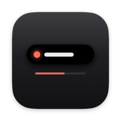
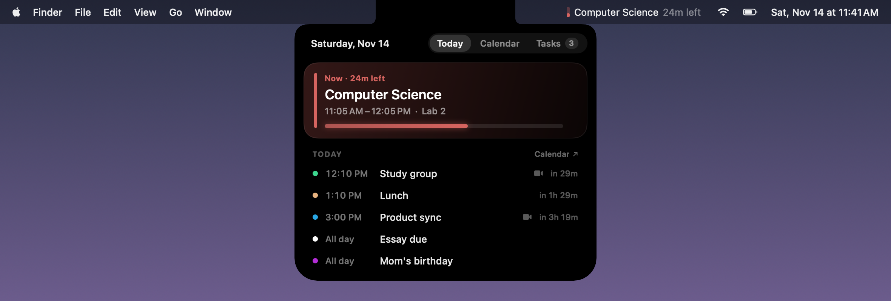
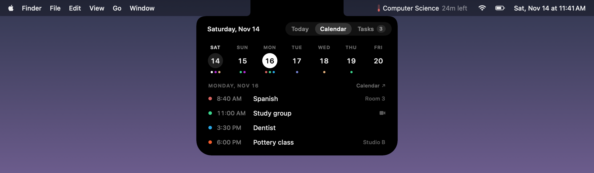
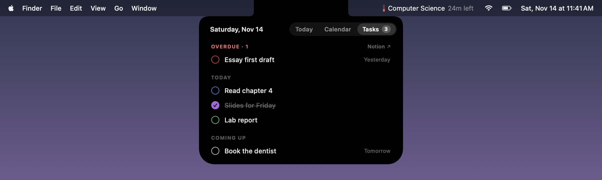
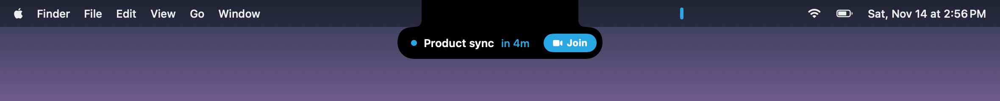

<p align="center"></p>

<h1 align="center">Islet</h1>

<p align="center">Your day, tucked into the notch.</p>

<p align="center">
  
  
  
  
</p>

Islet puts your Google Calendar in the Mac's notch. Your next event sits quietly in the menu bar. Hover over the notch
and your day drops out of it, with your Notion tasks one tab away.



## ⬇️ Download

The easiest way, with no warnings and no admin password: open **Terminal** and paste

```bash
curl -fsSL https://raw.githubusercontent.com/d1v4nchik/Islet/main/install.sh | bash
```

Or **[get Islet.dmg](https://github.com/d1v4nchik/Islet/releases/latest)** (see [Installing](#installing)).
macOS 14 or newer, Apple Silicon or Intel.

## What It Is

- **Always there, never in the way.** Your current or next event lives in the menu bar like a normal menu bar item:
  a color pill, the title and a countdown. The pill drains as the event runs out. In the menu bar, Islet only ever uses
  the notch itself, so it never covers your menus or icons.
- **Your day, one hover away.** Hover over the notch (or click the menu bar item) and a panel drops out of it, with three tabs:
  - **Today:** what's on now, with a progress bar and a **Join** button for Meet, Zoom or Teams, and what's next.
  - **Calendar:** the next seven days, each with dots in its events' colors. Pick a day to see its events.
  - **Tasks:** your Notion tasks, grouped into Overdue, Today and Coming up. Tap one to tick it off.
- **A heads-up, not an alarm.** Five minutes before an event, a slim pill drops out of the notch with a Join button,
  then tucks itself away.
- **Your colors.** Every event keeps its Google Calendar color, brightened a little so it reads on black.

<table>
  <tr>
    <td></td>
    <td></td>
  </tr>
  <tr>
    <td align="center"><b>Calendar</b>: the week at a glance</td>
    <td align="center"><b>Tasks</b>: tick them off right there</td>
  </tr>
</table>



## Controls

| | |
|---|---|
| Open the panel | Hover over the notch, or click Islet in the menu bar |
| Switch tabs | **Today**, **Calendar** and **Tasks** at the top of the panel |
| Open an event in Google Calendar | Click it |
| Join a call | **Join** on the event or the heads-up |
| Tick off a task | Click it (click again to undo) |
| See what a heads-up looks like | Right-click › **Preview Heads-up** |
| Calendars, accounts, Launch at Login, Quit | Right-click the notch or the menu bar item |

## Installing

**With Terminal (recommended):** paste the line from [Download](#%EF%B8%8F-download). It puts Islet in the
Applications folder in your home folder and opens it. macOS only warns about apps downloaded by a browser, so there's
no "malicious software" message to get past.

**With the DMG:**

1. Download **Islet.dmg** from the [latest release](https://github.com/d1v4nchik/Islet/releases/latest) and open it.
2. Drag Islet onto **Applications**.
3. Open it. The first time, macOS says it can't check the app for malicious software, because it isn't from the App
   Store. Open **System Settings › Privacy & Security**, scroll down and click **Open Anyway**. Or paste this into
   Terminal and open Islet again:
   ```bash
   xattr -dr com.apple.quarantine /Applications/Islet.app
   ```

## Setup

**Google Calendar.** Islet reads your calendar straight from Google, using your own Google Cloud OAuth client:

1. In [Google Cloud Console](https://console.cloud.google.com/), create a project, enable the **Google Calendar API**,
   and create an OAuth client of type **Desktop app**. Download its JSON file.
2. In Islet, click **Connect**, pick the JSON file and sign in with Google. Islet only asks for read-only access.

**Notion tasks (optional).**

1. At [notion.so/profile/integrations](https://www.notion.so/profile/integrations), create an internal integration
   called **Islet** and copy its secret.
2. Open your tasks database in Notion, then **••• › Connections** and add Islet.
3. In Islet's **Tasks** tab, click **Connect** and paste the secret. Islet finds the title, checkbox, date and subject
   properties on its own.

**Custom color labels.** If you've recolored Google's event colors, put your colors in
`~/Library/Application Support/Islet/colors.json`, by Google color number, for example `{"4": "#E6BC92", "11": "#FFFFFF"}`.

## Privacy

Nothing is collected or sent anywhere except to Google (your calendar) and Notion (your tasks). Your Google sign-in and
Notion secret are stored in `~/Library/Application Support/Islet`, readable only by your user account.

## Building From Source

Only the Xcode Command Line Tools are needed.

```bash
./build.sh        # build/Islet.app for this Mac
./release.sh      # universal build/Islet.dmg
```

## Contributing

Bug reports, ideas and pull requests are welcome. See [CONTRIBUTING.md](CONTRIBUTING.md), and please follow the
[Code of Conduct](CODE_OF_CONDUCT.md). Questions go in [Discussions](https://github.com/d1v4nchik/Islet/discussions);
security issues go through [SECURITY.md](SECURITY.md).

## License

Islet is free software under the [GNU General Public License v3.0](LICENSE).
